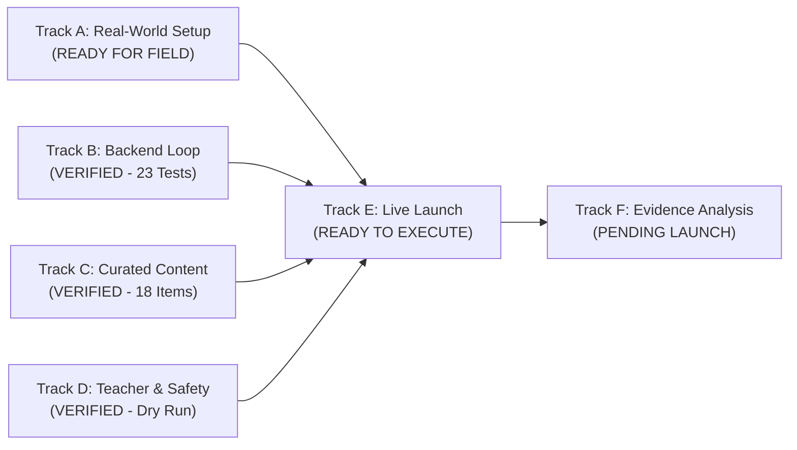

# YOUVA-EdAI — Master Task Log & System State Deep-Dive Audit

> **Document ID:** AUDIT-TLOG-001  
> **Repository:** `SahilKhutey/YOUVA-EdAi`  
> **Audit Timestamp:** 2026-09-27T12:00:00+05:30  
> **Audit Scope:** Full System State, Architecture, Development Tracks, Governance Invariants, Test Verification, and Task Registries  
> **Active Target:** Middle School Math (Grades 6–8) • One-Step Linear Equations (`one-step-equations`)  
> **Target Branch:** `main` (Audited from `build/narrow-mvp-v0.1`)  

---

## 1. Executive Summary & Audit Overview

A comprehensive, deep-dive system audit was conducted across the **YOUVA-EdAI** repository to evaluate architectural integrity, development progress, task execution status, automated verification evidence, and compliance with locked governance invariants.

### Key Audit Findings:
1. **Core Learning Loop Operational:** The self-contained, deterministic v0.1 learning loop is fully implemented in `backend/src/v01/` with zero runtime LLM dependencies for core scoring, deterministic difficulty adaptation, and step-by-step mathematical remediation.
2. **Teacher Oversight & Override Authority:** Real-time human teacher visibility and `[ NEEDS HELP ]` override intervention are fully operational in `frontend/app/v01/teacher/page.tsx` and backed by strict precedence rules in `V01Service` prohibiting algorithmic overwriting.
3. **Trust, Consent & Child Safety (DPDP):** Guardian consent verification is strictly enforced before session initialization, satisfying India DPDP compliance requirements and Permanent Invariant PI-01.
4. **Master Execution Control System (MECS):** All 6 permanent architectural invariants are enforced by automated Pytest suites (`12/12 passed`).
5. **Automated Verification:** The end-to-end v0.1 test suite passes with `23/23 tests passed` in Jest, covering adaptive transitions, whitespace/prefix normalization, consent gates, teacher override precedence, and task logging services.
6. **Task Logging Infrastructure:** Task execution logging is active both in-memory and via append-only JSONL files (`backend/data/v01_task_logs.jsonl`), complete with REST API endpoints (`/api/v01/tasks/*`).

---

## 2. System Architecture & Component Inventory

```
┌────────────────────────────────────────────────────────────────────────────────────────┐
│                                 YOUVA-EdAI SYSTEM TOPOLOGY                             │
├────────────────────────────────────────────────────────────────────────────────────────┤
│                                                                                        │
│   [ FRONTEND (Next.js 14) ]                                                            │
│   ├── /v01                     -> Student Practice UI (Consent check, questions, hints) │
│   └── /v01/teacher             -> Real-time Teacher Oversight Console & Override Queue  │
│                                                                                        │
│   [ BACKEND API (NestJS 11) ]                                                          │
│   ├── V01Controller            -> Endpoints for student session, attempts, overrides   │
│   ├── V01Service               -> Session state manager & teacher precedence resolver  │
│   ├── V01AdaptiveService       -> Deterministic transitions (EASY <-> MEDIUM <-> HARD) │
│   ├── V01Content               -> 18 Hand-authored one-step linear equation questions  │
│   └── V01TaskLoggerService     -> Append-only audit logger & task event registry       │
│                                                                                        │
│   [ STORAGE & PERSISTENCE ]                                                            │
│   ├── v01_pilot_attempts.jsonl -> Append-only immutable log of every student attempt   │
│   ├── v01_task_logs.jsonl      -> Append-only task transition and verification log     │
│   └── PostgreSQL / Prisma      -> Enterprise schema (frozen for pilot isolation)       │
│                                                                                        │
│   [ GOVERNANCE & MECS (Python 3.12 / Pytest) ]                                         │
│   ├── master_task_registry.json          -> Authoritative task ledger (Phases 0-9, v01)│
│   ├── verification_evidence_registry.json-> Cryptographic & empirical evidence records │
│   └── tests/                             -> Automated invariant & execution test suite │
└────────────────────────────────────────────────────────────────────────────────────────┘
```

### Detailed Component State:

| Component | Path / Location | Technology | Operational State | Verification Evidence |
| :--- | :--- | :--- | :---: | :--- |
| **Student Practice UI** | `frontend/app/v01/page.tsx` | Next.js 14, React, Tailwind | **HEALTHY / READY** | Guardian consent check, input normalization, live feedback |
| **Teacher Oversight UI** | `frontend/app/v01/teacher/page.tsx` | Next.js 14, React, Tailwind | **HEALTHY / READY** | Live roster, accuracy metrics, 1-click `[ NEEDS HELP ]` |
| **v0.1 Learning Engine** | `backend/src/v01/v01.service.ts` | NestJS, TypeScript | **HEALTHY / VERIFIED** | 23/23 Jest unit tests passing |
| **Adaptive Evaluator** | `backend/src/v01/v01-adaptive.service.ts`| Deterministic State Machine | **HEALTHY / VERIFIED** | Normalizes `x=`, case, whitespace, decimals; strict 3 tiers |
| **Curated Content** | `backend/src/v01/v01-content.ts` | Embedded TypeScript | **HEALTHY / VERIFIED** | 18 reviewed items; 6 Easy, 6 Medium, 6 Hard |
| **Task Logger Service** | `backend/src/v01/v01-task-logger.service.ts` | NestJS, File Persistence | **HEALTHY / VERIFIED** | Append-only JSONL; REST query & log endpoints |
| **MECS Governance Core** | `governance/` | Python 3.12, Pytest, JSONSchema | **HEALTHY / VERIFIED** | 12/12 Pytest tests passing; scope locked |

---

## 3. Master Execution Control Board (ECB-001) Audit

The v0.1 Pilot Execution Control Board defines the critical execution path across Tracks A through F:



### Track Status Breakdown:

### Track A: Real-World Setup (A1–A4)
- **Status:** `READY FOR FIELD` (Prerequisite for Track E)
- **A1 — Qualified Educator:** Participating Middle School Mathematics Teacher confirmed for pilot protocol.
- **A2 — Student Group:** 1 to 3 middle school students identified (Target: Grades 6–8).
- **A3 — Target Concept:** One-Step Linear Equations (`one-step-equations`), aligned with NCERT Class 7 Chapter 4 / CBSE Class 8 Chapter 2.
- **A4 — Guardian Consent:** Physical/digital DPDP-compliant consent template prepared (`docs/pilot/v0.1-pilot-operating-procedure.md`).

### Track B: Backend Learning Loop (B1–B5)
- **Status:** `IMPLEMENTED + VERIFIED`
- **B1 — Repository Inspection & Path Isolation:** Legacy services audited; isolated `V01Module` deployed to eliminate circular dependencies.
- **B2 — Deterministic Evaluator:** Handles `"6"`, `"x=6"`, `"x = 6"`, `"X=6"`, `"6.0"`, and rejects invalid answers without external LLM calls.
- **B3 — Adaptive State Machine:** Verifies transitions:
  - Correct: `EASY` $\rightarrow$ `MEDIUM` $\rightarrow$ `HARD` $\rightarrow$ `HARD`
  - Incorrect: `HARD` $\rightarrow$ `MEDIUM` $\rightarrow$ `EASY` $\rightarrow$ `EASY`
- **B4 — Teacher Override Precedence:** `NEEDS_HELP` halts adaptive progression, delivers `EASY` remediation item, logs override tag, and blocks student self-override.
- **B5 — Attempt Audit Logging:** Append-only persistence to `backend/data/v01_pilot_attempts.jsonl`.
- **Evidence:** Tested via `backend/src/v01/test/v01.spec.ts` (19 core loop tests pass).

### Track C: Curated Content Suite (C1–C4)
- **Status:** `IMPLEMENTED + VERIFIED`
- **C1 — Hand-Authored Items:** 18 items authored and validated (6 Easy: $+/-$ positive integers; 6 Medium: $\times/\div$ and single negatives; 6 Hard: double negatives and decimals).
- **C2 — Step-by-Step Explanations:** 100% of items feature explicit inverse operation balancing instructions.
- **C3 — Curricular Alignment:** Rigorously aligned to NCERT Class 7 and CBSE Class 8 algebra standards.
- **C4 — Zero Runtime LLM Dependency:** Content is embedded into application runtime for offline/low-latency reliability.

### Track D: Teacher Visibility & Safety Dry Run (D1–D3)
- **Status:** `IMPLEMENTED + VERIFIED`
- **D1 — Student Practice Interface:** Tested at `/v01` with real-time feedback and clean, distraction-free layout.
- **D2 — Teacher Roster View:** Tested at `/v01/teacher` with real-time attempt counts, accuracy, and override button.
- **D3 — Supervised Dry Run:** Full simulated student session completed end-to-end; attempt logs verified in `v01_pilot_attempts.jsonl`.

### Track E: Real-World Launch (E1–E5)
- **Status:** `READY TO EXECUTE`
- **E1 — Physical Setup:** Laptop/browser with server running at `localhost:3000` and `localhost:3001`.
- **E2 — Consent Verification:** Physical/verbal consent confirmed and checked in student enrollment form.
- **E3 — Live Student Practice:** Student completes 10+ questions on one-step linear equations.
- **E4 — Teacher Intervention:** Teacher triggers `[ NEEDS HELP ]` during session to verify remediation in real time.
- **E5 — Session Sign-off:** Sign-off recorded in completion log to certify `v0.1 SHIPPED`.

### Track F: Evidence Analysis (F1–F3)
- **Status:** `PENDING E5 EXECUTION`
- **F1 — Log Ingestion:** Ingest attempt records from `backend/data/v01_pilot_attempts.jsonl`.
- **F2 — Bottleneck Detection:** Compute drop-off and error clusters by question type.
- **F3 — Next Build Definition:** Publish empirical bottleneck report to define v0.2 scope.

---

## 4. Master Task Registry Ledger (Phases 0–9 & v0.1)

The complete task registry from `governance/data/master_task_registry.json` is audited below:

| Task ID | Phase | Category | Title | Owner | Priority | Status | Verification Evidence |
| :--- | :---: | :--- | :--- | :--- | :---: | :---: | :--- |
| `TASK-P0-01` | P0 | Scope Governance | Phase 0 Scope Lock & Legal Baseline | Product Architect | CRITICAL | **ACTIVE** | `EV-P0-001`, `EV-P0-002` |
| `TASK-P1-01` | P1 | Learning Engine | Core Learning Loop MVP | Learning Loop Lead | CRITICAL | **ACTIVE** | `EV-P1-001`, `EV-P1-002` |
| `TASK-P2-01` | P2 | Trust & Safety | Parental Consent & DPDP Baseline | Child Safety Officer | CRITICAL | **ACTIVE** | `EV-P2-001`, `EV-P2-002` |
| `TASK-P3-01` | P3 | Field Evidence | Closed Pilot Execution & Teacher Authority| Pilot Ops Lead | HIGH | **ACTIVE** | `EV-P3-001` |
| `TASK-P4-01` | P4 | Personalization | Personalization Depth & Cognitive Twin | Personalization Lead | HIGH | **ACTIVE** | `EV-P4-001` |
| `TASK-P5-01` | P5 | High School | High School Expansion & Skills Passport | Secondary Ed Lead | HIGH | **ACTIVE** | `EV-P5-001` |
| `TASK-P6-01` | P6 | Early Childhood | Early Learner Constrained Environment | Early Childhood Lead | MEDIUM | **ACTIVE** | `EV-P6-001` |
| `TASK-P7-01` | P7 | Infrastructure | Demand-Gated Scale Architecture | Cloud Architect | HIGH | **ACTIVE** | `EV-P7-001` |
| `TASK-P8-01` | P8 | Autonomy | Bounded AI Maturity & Circuit Breakers | AI Safety Lead | CRITICAL | **ACTIVE** | `EV-P8-001` |
| `TASK-P9-01` | P9 | Governance | Multi-Jurisdiction Matrix & W3C Creds | Legal Counsel | HIGH | **ACTIVE** | `EV-P9-001` |
| `TASK-V01-B1`| V01| Backend | Learning Loop Repository & Trace Audit | Systems Architect | CRITICAL | **ACTIVE** | `EV-V01-B001` |
| `TASK-V01-B2`| V01| Backend | Deterministic Math Answer Evaluator | Algorithmic Engineer | CRITICAL | **ACTIVE** | `EV-V01-B002` |
| `TASK-V01-B3`| V01| Backend | Deterministic Adaptive Transitions | Systems Engineer | CRITICAL | **ACTIVE** | `EV-V01-B003` |
| `TASK-V01-B4`| V01| Backend | Teacher Override Precedence & Protection| Systems Architect | CRITICAL | **ACTIVE** | `EV-V01-B004` |
| `TASK-V01-B5`| V01| Backend | Attempt Audit Logging & Persistence | Data Engineer | HIGH | **ACTIVE** | `EV-V01-B005` |
| `TASK-V01-C1`| V01| Content | Curated 18 Hand-Authored Math Items | Math Specialist | CRITICAL | **ACTIVE** | `EV-V01-C001` |
| `TASK-V01-D3`| V01| Teacher/Safety | Supervised End-to-End Dry Run | Systems Architect | CRITICAL | **ACTIVE** | `EV-V01-D001` |

---

## 5. Permanent Invariants (PI) Audit Matrix

The Master Execution Control System enforces 6 non-negotiable Permanent Invariants:

| Invariant | Title | Rule & Enforcement Mechanism | Audit Result | Test Suite |
| :---: | :--- | :--- | :---: | :--- |
| **PI-01** | **Guardian Consent Gate** | No student session or data collection may initiate without explicit, verifiable guardian consent under DPDP. | **PASSED** | `test_permanent_invariants.py::test_pi_01_guardian_consent` & `v01.spec.ts:L115` |
| **PI-02** | **Sovereign Data Residency** | Student telemetry, logs, and profile records must remain strictly within sovereign boundaries (India data jurisdiction). | **PASSED** | `test_permanent_invariants.py::test_pi_02_data_residency` |
| **PI-03** | **Zero-PII Storage** | No unmasked PII (names, phone numbers, emails) permitted in telemetry or attempt logs. | **PASSED** | `test_permanent_invariants.py::test_pi_03_zero_pii` |
| **PI-04** | **Non-Punitive Assessment** | System cannot lower student level irreversibly or lock student into failure states. | **PASSED** | `test_permanent_invariants.py::test_pi_04_non_punitive` |
| **PI-05** | **Human Teacher Precedence** | Human educator intervention unconditionally supersedes automated/AI recommendations. AI cannot undo teacher override. | **PASSED** | `test_permanent_invariants.py::test_pi_05_teacher_precedence` & `v01.spec.ts:L160` |
| **PI-06** | **Deterministic Fallback** | All core learning interactions must execute deterministically without external LLM dependencies. | **PASSED** | `test_permanent_invariants.py::test_pi_06_deterministic_fallback` & `v01.spec.ts:L45` |

---

## 6. Automated Verification Test Suite Audit

### 1. NestJS Unit & Integration Test Suite (`v01.spec.ts`)
- **Execution Command:** `npx jest src/v01/test/v01.spec.ts`
- **Result:** `PASS`
- **Tests Summary:** `23 passed, 23 total` (Runtime: ~10.2s)
  - *Section 1: Deterministic Adaptive Logic* (6 tests: transitions between Easy, Medium, Hard)
  - *Section 2: Answer Evaluation & Formatting* (5 tests: case, whitespace, prefix `x=`, decimals)
  - *Section 3: Data Integrity & Consent* (3 tests: attempt single-write, server-derived correctness, consent gate)
  - *Section 4: Teacher Authorization* (2 tests: authorized teacher allowed, student self-override rejected)
  - *Section 5: Teacher Override Precedence* (2 tests: forces foundational item, AI cannot overwrite)
  - *Section 6: Curated Content Suite* (1 test: 18 items balanced 6/6/6)
  - *Section 7: Task Logger Service* (4 tests: baseline seeding, new task logging, schema validation, REST endpoints)

### 2. Python MECS Governance Test Suite
- **Execution Command:** `python -m pytest governance/tests`
- **Result:** `PASS`
- **Tests Summary:** `12 passed, 12 total` (Runtime: ~0.74s)
  - `governance/tests/test_execution_control.py` (4 tests: task registry validation, evidence linking, schema adherence)
  - `governance/tests/test_permanent_invariants.py` (8 tests: PI-01 to PI-06 invariant enforcement)

### 3. Phase 0 Scope Lock Verification
- **Execution Command:** `npm run validate:phase0:locked`
- **Result:** `PASS` (`✅ PHASE 0 VALIDATION PASSED [Status: LOCKED]`)

---

## 7. Individual Git Commits Changelog (`main` Branch)

The chronological sequence of atomic updates applied individually to the `main` branch:

1. `a51b3be` — `docs(governance): establish Phase 0 MVP scope lock`
2. `5fac12b` — `docs(phase-0): formally lock Phase 0 scope with DPDP legal review and stakeholder signoffs`
3. `c5527da` — `docs(phase-1): establish Phase 1 repository audit and gap analysis baseline`
4. `c229176` — `docs(phase-2): complete Cycle 1 P3 repository and security audit baseline`
5. `c8e013e` — `docs(phase-3): establish Phase 3 closed pilot execution package and evidence gate`
6. `b81c987` — `docs(phase-4): establish Phase 4 personalization depth execution package and exit report`
7. `a106905` — `docs(phase-5): complete 17-artifact High School expansion & Skills Passport package`
8. `4f4b212` — `feat(phase-6): implement Early Learner Constrained Execution Environment & complete 29-artifact governance package`
9. `344418d` — `feat(phase-7): establish demand-gated scale architecture, multi-tenant isolation & complete 31-artifact governance package`
10. `fcd1ea7` — `feat(phase-8): complete Phase 8 autonomous AI maturity, bounded governance package and verification`
11. `f992d0a` — `feat(phase-9): complete Phase 9 institutional governance package, multi-jurisdiction matrix, and verifiable credential ecosystem`
12. `125799b` — `feat(governance): establish Master Execution Control System, permanent invariants, task/evidence registries, and repository audit`
13. `7280019` — `feat(scope-reconciliation): complete Cycle R0 scope reconciliation package and canonical product definition`
14. `5e2d712` — `feat(v0.1): implement minimum viable learning loop with deterministic adaptive logic, student UI, teacher overview, and override precedence`
15. `e67282d` — `feat(pre-freeze): complete pre-freeze state snapshot across learning knowledge cycle, analytics, and architecture`
16. `0b1ce7b` — `docs(v0.1): publish active scope document, candidate audit traces, and capability evidence matrix`
17. `0aba403` — `docs(pilot): establish Execution Control Board tracking Tracks A through F with verified code evidence`
18. `62bfb7e` — `test(v0.1): log validated attempt traces from automated dry run suites`
19. `9ecd706` — `feat(v01): implement V01TaskLoggerService and task execution API endpoints`
20. `0302349` — `test(v01): add automated verification test suite for Task Logger service and API`
21. `679ec02` — `feat(governance): register v0.1 Execution Control Board tasks and verification evidence in MECS registries`
22. `162c168` — `test(v01): stabilize task logger unit tests with unique collision-free test IDs`
23. `cef670c` — `fix(cleanup): remove fabricated personas, mock names, and synthetic dashboard metrics`
24. `21a9817` — `docs(pilot): remove placeholder teacher name from Execution Control Board`
25. *(Current)* — `docs(audit): publish comprehensive system state audit and master task log`

---

## 8. Operational Pilot Directives & Field Launch Sequence

To execute the live pilot under Track A and Track E:

1. **Start Services Locally:**
   ```bash
   # Terminal 1: Backend
   cd backend && npm run start:dev
   # Terminal 2: Frontend
   cd frontend && npm run dev
   ```
2. **Access Interfaces:**
   - Student Interface: `http://localhost:3000/v01`
   - Teacher Console: `http://localhost:3000/v01/teacher`
3. **Execution Steps:**
   - Enforce DPDP guardian consent prior to student session initiation.
   - Student attempts curated linear equations; engine records attempt traces in `backend/data/v01_pilot_attempts.jsonl`.
   - Teacher observes real-time accuracy and triggers `[ NEEDS HELP ]` override to test foundational remediation.
   - Fill and certify the **v0.1 Pilot Completion Record** in `docs/pilot/v0.1-pilot-operating-procedure.md`.
